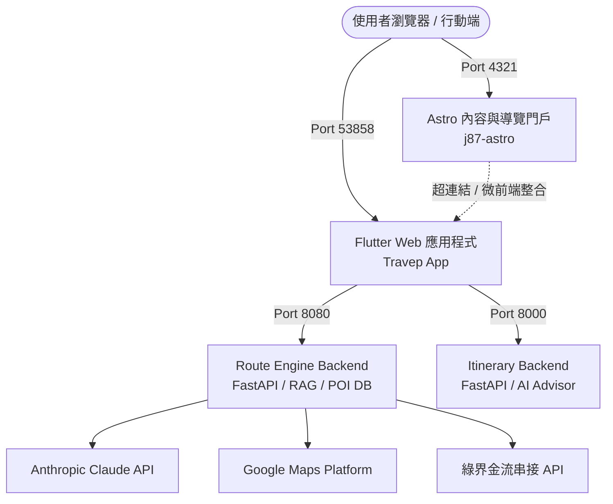
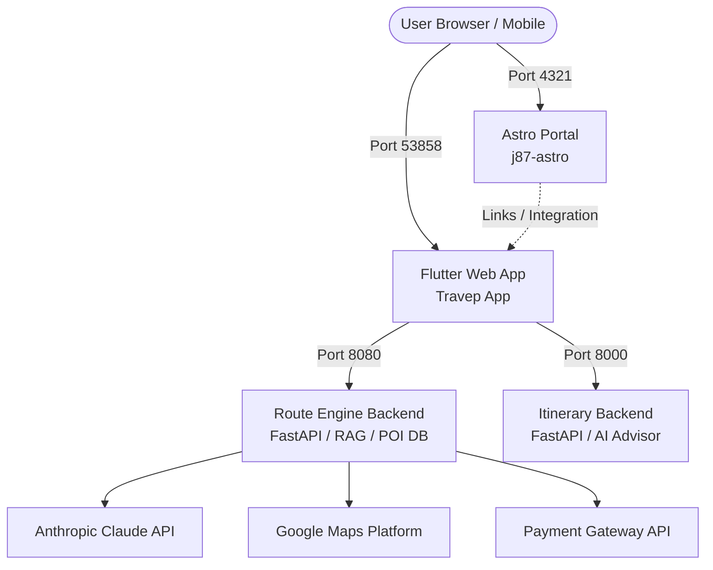

<div align="center">

# 🌏 Travep App (Trivep)

**全方位智慧旅遊規劃與戶外登山系統**  
**All-in-One Intelligent Travel Planning & Outdoor Suite**

[](https://flutter.dev)
[](https://fastapi.tiangolo.com)
[](https://astro.build)
[](https://www.anthropic.com)
[](https://developers.google.com/maps)
[](https://opensource.org/licenses/MIT)

<br/>

[繁體中文](#-繁體中文) • [English](#-english) • [日本語](#-日本語) • [한국어](#-한국어)

</div>

---
完整網站： https://www.j87.org/

## 🎬 示範影片 / Demo Video

> 📹 **YouTube 示範展示影片（即將上線 / Coming Soon）**  
> 點擊下方縮圖觀看操作教學與功能介紹：  
> 
> [](https://www.youtube.com/watch?v=YOUTUBE_VIDEO_ID_HERE)  
> *(預留位置：稍後可將 `YOUTUBE_VIDEO_ID_HERE` 替換為實際的 YouTube 影片 ID)*

---

# 🇹🇼 繁體中文

## 📖 專案簡介 (Overview)

**Travep App** 是一個專為自由行旅客與戶外愛好者打造的現代化行程排定平台。傳統旅遊工具往往將「景點搜尋」與「路線排序」割裂，導致排行程耗費數天。

本專案透過 **LLM + 輕量化 RAG 知識庫**，在對話中即時給出帶有真實地理座標（WGS84）的客製行程；並串接 **TSP（旅行推銷員問題）啟發式路線優化引擎**，讓使用者一鍵將 AI 建議套用至編輯器，進行天數拆解、航點拖曳與地圖動線視覺化。

---

## ✨ 核心特色 (Key Features)

### 🤖 1. AI 智慧行程規劃 (Smart Trip Planner)
* **LLM 驅動**：串接 Anthropic Claude 3.5 模型，依據預算、天數、同伴組成自動策劃每日主題行程。
* **全球 RAG 經緯度知識庫**：內建巴塞隆納、東京、巴黎、羅馬等全域 POI 座標，解決大語言模型輸出虛構地點或缺漏經緯度的問題。
* **一鍵套用至編輯器**：AI 產出的行程可直接轉換為專案，無縫導入路線優化器編輯。

### 🧭 2. 全球路線優化器 (Global Route Optimizer)
* **雙模式支援**：支援手動排序（Manual Mode）與演算法自動分析（TSP Mode）。
* **多日動線管理**：支援將景點跨日搬移、設定必訪航點鎖定（Locking）、自訂交通耗時評估。
* **Google Maps 整合**：即時繪製路徑 Polyline、標記點聚合與互動式卡片。

### 🌐 3. 現代微前端與混合架構 (Hybrid Architecture)
* **Astro 內容門戶**：負責極速靜態內容、多國語言網誌（中/英/日/越）、SEO 與活動登陸頁。
* **Flutter Web 應用**：鎖定於固定連接埠 `53858`，支援原生 CanvasKit GPU 加速繪圖。
* **雙向 URL 深度連結**：網址列即時支援 `?page=11` 等參數導頁，支援瀏覽器上一頁/下一頁動態監聽。

### 🏔️ 4. 山系登山套裝 (Mountain Suite Monorepo)
* **GPX 軌跡工具**：支援 GPX 軌跡檔解析、高度落差圖繪製與多重軌跡合併。
* **離線地圖支援**：針對戶外無網路環境提供專屬離線快取方案。

---

## 🏛️ 系統架構 (Architecture)



### 服務連接埠配置：
| 連接埠 | 服務名稱 | 說明 |
| :---: | :--- | :--- |
| `53858` | **Flutter Web App** | 主應用前端（可自帶 `?page=11` 直達功能） |
| `4321` | **Astro Frontend** | 部落格、說明文件與功能入口門戶 |
| `8080` | **Route Engine Backend** | 景點探索、RAG 知識庫、機票推薦、綠界金流 |
| `8000` | **Itinerary Backend** | 行程計算與 AI 建議顧問服務 |

---

## 📁 專案目錄結構 (Project Structure)

```text
trivep_app/
├── lib/                         # Flutter 核心業務邏輯與 UI 頁面
│   ├── features/
│   │   ├── home/                # 首頁推播與快速啟動卡片
│   │   ├── smart_planning/      # AI 行程規劃與路線編輯器
│   │   ├── favorites/           # 景點收藏與專案管理
│   │   └── route_engine/        # 地圖與路徑服務
│   └── core/utils/              # 跨平台 Web 導航監聽工具
├── backend/                     # Itinerary 後端服務 (Port 8000)
├── route_engine_backend/        # Route Engine 後端服務 (Port 8080)
├── j87-astro/                   # Astro 內容與微前端門戶 (Port 4321)
├── mountain_suite_monorepo/     # 登山 GPX 套裝 Monorepo
├── run_flutter_web.sh           # Flutter Web 固定埠專屬啟動腳本
├── start_dev.sh                 # 全環境一鍵啟動腳本
└── stop_dev.sh                  # 全環境一鍵停止腳本
```

---

## 🚀 快速開始 (Quick Start)

### 前置需求 (Prerequisites)
* [Flutter SDK](https://docs.flutter.dev/get-started/install) (>= 3.22)
* [Python](https://www.python.org/) (>= 3.9) 與 `venv`
* [Node.js](https://nodejs.org/) (>= 20.x)
* Google Chrome 瀏覽器

### 1. 複製環境變數範本
專案採用**零信任（Zero-Trust）**設計，真實金鑰不入庫。請複製範本並填入您的 API Key：
```bash
cp .env.example .env
cp backend/.env.example backend/.env
cp route_engine_backend/.env.example route_engine_backend/.env
```

### 2. 安裝依賴
```bash
# Flutter 套件安裝
flutter pub get

# 後端虛擬環境與套件 (8080 & 8000)
cd route_engine_backend && python3 -m venv venv && ./venv/bin/pip install -r requirements.txt && cd ..
cd backend && python3 -m venv venv && ./venv/bin/pip install -r requirements.txt && cd ..

# Astro 前端套件
cd j87-astro && npm install && cd ..
```

### 3. 一鍵啟動所有服務
```bash
# 啟動全部服務 (Astro + 雙後端 + Flutter Web)
./start_dev.sh

# 或者：只單獨啟動 Flutter Web（固定埠 53858）
./run_flutter_web.sh
```

服務啟動後即可在瀏覽器開啟：
* 📱 **Travep 應用首頁**：[http://localhost:53858/](http://localhost:53858/)
* 🤖 **AI 智慧行程規劃直達**：[http://localhost:53858/?page=11](http://localhost:53858/?page=11)
* 🧭 **全球路線優化直達**：[http://localhost:53858/?page=9](http://localhost:53858/?page=9)
* 🌐 **Astro 門戶首頁**：[http://localhost:4321/](http://localhost:4321/)

---

## 🔒 安全性聲明 (Security Notice)

* 本專案已落實安全過濾，所有私鑰（`*.key`、`*.pem`）、認證金鑰（Google Maps、Anthropic API Key、Firebase Service Account）、個人照片與工作日誌皆已自版控排除。
* 欲啟用真實地圖圖資與 AI 對話，請於 `.env` 自行配置對應之 API Key（如 [Google Cloud Console](https://console.cloud.google.com/) 與 [Anthropic Console](https://console.anthropic.com/)）。

---

# 🇺🇸 English

## 📖 Overview

**Travep App** is an all-in-one smart travel planning and outdoor adventure platform. Traditional travel planning tools often disconnect destination discovery from route sequencing, turning trip preparation into a tedious multi-day ordeal.

This project bridges that gap by combining **LLMs with a lightweight RAG knowledge base** to generate custom, context-aware itineraries with real WGS84 coordinates. It seamlessly feeds into a **TSP-based heuristic route optimizer**, allowing travelers to convert AI suggestions into an interactive editing dashboard with waypoint dragging, day splitting, and map-based polyline visualization.

---

## ✨ Key Features

### 🤖 1. Smart Trip Planner (AI + RAG)
* **LLM Engine**: Powered by Anthropic Claude 3.5, creating realistic daily itineraries tailored to your budget, travel dates, and group size.
* **Global POI Knowledge Base**: Includes authentic geographic coordinates for major destinations (Barcelona, Tokyo, Paris, Rome, etc.), preventing hallucinated coordinates.
* **One-Click Application**: Directly push AI itineraries into the Global Optimizer for timeline and route adjustments.

### 🧭 2. Global Route Optimizer (Manual & TSP)
* **Dual Operation Modes**: Manual drag-and-drop sequencing and automated Traveling Salesperson Problem (TSP) optimization.
* **Multi-Day Management**: Reorder attractions between days, lock critical stops, and calculate travel durations.
* **Google Maps Integration**: Live route polyline rendering, marker clustering, and interactive spot details.

### 🌐 3. Hybrid Micro-Frontend Architecture
* **Astro Content Portal**: Blazing-fast static site hosting multilingual blogs (ZH, EN, JA, VI), documentation, and landing pages.
* **Flutter Web Application**: Fixed to dev port `53858` with native CanvasKit GPU-accelerated rendering.
* **Bidirectional URL Deep Linking**: Full query parameter routing (`?page=11`) with synchronized browser history (`popstate`/`pushState`).

### 🏔️ 4. Mountain Suite (Outdoor Monorepo)
* **GPX Track Toolkit**: Parse GPX tracks, render elevation profiles, and merge multiple trail logs.
* **Offline Readiness**: Built with field use in mind for low-connectivity environments.

---

## 🏛️ System Architecture



### Port Configuration:
| Port | Service | Description |
| :---: | :--- | :--- |
| `53858` | **Flutter Web App** | Main client app (Direct deep link: `?page=11`) |
| `4321` | **Astro Portal** | Documentation, blog, and navigation gateway |
| `8080` | **Route Engine Backend** | Spot explorer, RAG database, flights, payments |
| `8000` | **Itinerary Backend** | Route calculations & AI advisor services |

---

## 🚀 Quick Start (English)

### Prerequisites
* [Flutter SDK](https://docs.flutter.dev/get-started/install) (>= 3.22)
* [Python](https://www.python.org/) (>= 3.9) with `venv`
* [Node.js](https://nodejs.org/) (>= 20.x)
* Google Chrome

### 1. Setup Environment
```bash
cp .env.example .env
cp backend/.env.example backend/.env
cp route_engine_backend/.env.example route_engine_backend/.env
```

### 2. Install Dependencies
```bash
# Flutter dependencies
flutter pub get

# Backends (8080 & 8000)
cd route_engine_backend && python3 -m venv venv && ./venv/bin/pip install -r requirements.txt && cd ..
cd backend && python3 -m venv venv && ./venv/bin/pip install -r requirements.txt && cd ..

# Astro portal
cd j87-astro && npm install && cd ..
```

### 3. Launch Services
```bash
# Launch full stack (Astro + Both Backends + Flutter Web)
./start_dev.sh

# Or start Flutter Web only (Port 53858)
./run_flutter_web.sh
```

---

# 🇯🇵 日本語

## 📖 プロジェクト概要 (Overview)

**Travep App** は、個人旅行者やアウトドア愛好家のために設計された次世代のスマート旅行計画プラットフォームです。従来のツールでは観光地の検索とルート順序の最適化が分断されがちで、計画に何日もかかっていました。

本プロジェクトは **LLMと軽量なRAG知識ベース** を融合させ、対話の中で実在する地理座標（WGS84）を含むカスタム旅程を瞬時に生成します。さらに **TSP（巡回セールスマン問題）発見的ルート最適化エンジン** とシームレスに連携し、AIが提案したプランをワンクリックでエディターに適用、日別のドラッグ＆ドロップ調整や地図上のルート可視化が可能です。

---

## ✨ 主な機能 (Key Features)

### 🤖 1. AI スマート旅程プランナー (Smart Trip Planner)
* **LLM連携**：Anthropic Claude 3.5 を採用し、予算・日程・同行者に合わせた現実的なスケジュールを作成。
* **世界主要都市のRAG座標ベース**：東京、バルセロナ、パリ、ローマなどの正確なPOI座標を保持し、AI特有の座標ハルシネーションを防止。
* **ワンクリック適用**：生成された旅程を瞬時にプロジェクト化し、ルートオプティマイザーで編集可能。

### 🧭 2. グローバルルートオプティマイザー (Global Route Optimizer)
* **デュアルモード対応**：直感的な手動並び替え（Manual）とアルゴリズムによる自動解析（TSP）を両立。
* **柔軟な日程管理**：日をまたいだスポット移動、特定スポットの固定（Locking）、移動時間のリアルタイム試算。
* **Google Maps統合**：ポリラインによる道順描画、マーカークラスタリング、インタラクティブカード表示。

### 🌐 3. ハイブリッド・マイクロフロントエンド
* **Astro ポータル**：超高速な静態ページ提供、多言語ブログ（中/英/日/越）、SEO対応。
* **Flutter Web**：専用ポート `53858` で動作し、CanvasKit による GPU ハードウェアアクセラレーション描画を実現。
* **双方向URLディープリンク**：`?page=11` などのクエリパラメータによるダイレクトナビゲーションと履歴同期。

### 🏔️ 4. 登山＆アウトドアスイート (Mountain Suite)
* **GPXツール**：GPXトラックログの解析、標高プロファイルグラフ描画、複数ルートの結合。
* **オフライン対応設計**：電波の届かない山岳地域でも利用可能なキャッシュアーキテクチャ。

---

## 🚀 クイックスタート (Japanese)

```bash
# 1. 環境変数の設定
cp .env.example .env
cp backend/.env.example backend/.env
cp route_engine_backend/.env.example route_engine_backend/.env

# 2. 依存関係のインストール
flutter pub get
cd route_engine_backend && python3 -m venv venv && ./venv/bin/pip install -r requirements.txt && cd ..
cd backend && python3 -m venv venv && ./venv/bin/pip install -r requirements.txt && cd ..
cd j87-astro && npm install && cd ..

# 3. サービスの一括起動
./start_dev.sh
```

---

# 🇰🇷 한국어

## 📖 프로젝트 개요 (Overview)

**Travep App**은 자유 여행객과 아웃도어 탐험가를 위해 설계된 올인원 스마트 여행 계획 플랫폼입니다. 기존 여행 플래너는 명소 탐색과 동선 최적화가 분리되어 있어 일정을 완성하는 데 많은 시간이 소요되었습니다.

본 프로젝트는 **LLM과 경량 RAG 지식 베이스**를 결합하여 실제 WGS84 지리 좌표가 포함된 맞춤형 일정을 실시간으로 생성합니다. 또한 **TSP(외판원 문제) 휴리스틱 최적화 엔진**과 완벽히 연동되어, AI 추천 일정을 한 번의 클릭으로 편집기에 적용하고 일자별 드래그 앤 드롭 및 지도 시각화를 손쉽게 수행할 수 있습니다.

---

## ✨ 핵심 기능 (Key Features)

### 🤖 1. AI 스마트 여행 플래너 (Smart Trip Planner)
* **LLM 파이프라인**: Anthropic Claude 3.5 모델을 통해 예산, 여행 일수, 인원 구성에 맞춘 테마별 일정 자동 생성.
* **글로벌 RAG 좌표 데이터베이스**: 바르셀로나, 도쿄, 파리, 로마 등 주요 도시의 실제 POI 좌표를 내장하여 AI의 좌표 왜곡(Hallucination) 방지.
* **원클릭 에디터 적용**: 생성된 일정을 프로젝트로 변환하여 글로벌 옵티마이저에서 즉시 편집 가능.

### 🧭 2. 글로벌 동선 최적화 (Global Route Optimizer)
* **듀얼 모드 지원**: 직관적인 수동 재배치(Manual) 및 알고리즘 기반 자동 최적화(TSP).
* **일자별 동선 관리**: 날짜 간 명소 이동, 필수 경유지 고정(Locking), 이동 소요 시간 자동 계산.
* **Google Maps 연동**: 경로 폴리라인(Polyline) 렌더링, 마커 클러스터링 및 대화형 카드 지원.

### 🌐 3. 모던 하이브리드 마이크로 프론트엔드
* **Astro 콘텐츠 포털**: 초고속 정적 사이트, 다국어 블로그(중/영/일/베), SEO 지원.
* **Flutter Web 애플리케이션**: 고정 포트 `53858`에서 실행되며 CanvasKit GPU 가속 렌더링 지원.
* **양방향 URL 딥링크**: `?page=11` 파라미터 기반 직접 이동 및 브라우저 히스토리(`popstate`) 실시간 동기화.

### 🏔️ 4. 아웃도어 & 등산 스위트 (Mountain Suite)
* **GPX 트랙 툴킷**: GPX 트랙 분석, 고도 프로필 차트 생성 및 다중 경로 병합 기능.
* **오프라인 환경 최적화**: 통신이 원활하지 않은 산악 환경을 위한 로컬 캐시 구조.

---

## 🚀 빠른 시작 (Korean)

```bash
# 1. 환경 변수 템플릿 복사
cp .env.example .env
cp backend/.env.example backend/.env
cp route_engine_backend/.env.example route_engine_backend/.env

# 2. 패키지 설치
flutter pub get
cd route_engine_backend && python3 -m venv venv && ./venv/bin/pip install -r requirements.txt && cd ..
cd backend && python3 -m venv venv && ./venv/bin/pip install -r requirements.txt && cd ..
cd j87-astro && npm install && cd ..

# 3. 전체 서비스 시작
./start_dev.sh
```

---

## 📄 License

This project is licensed under the [MIT License](LICENSE).
